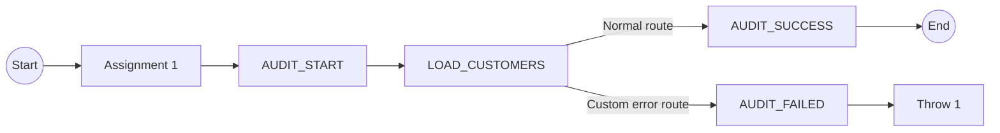

# Informatica CDI — CRM Customers Taskflow: As-Built Design

**Project:** Commerce Analytics Platform\
**Asset:** `tf_bronze_mysql_crm_customers_audit`\
**Informatica location:** `Default / 02_MYSQL_CRM_INGESTION`\
**Evidence captured:** 2026-10-18 — Informatica Taskflow Designer; `Assignment 1`, `AUDIT_START`, `AUDIT_SUCCESS`, `AUDIT_FAILED` and `LOAD_CUSTOMERS → Error Handling` properties screenshots\
**Document type:** Human-readable *as-built* design documentation; **not** an Informatica importable export\
**Status:** **PARTIALLY VERIFIED** — topology, UUID initialization, the three audit-step input bindings, and `LOAD_CUSTOMERS` error-handling configuration are documented. User confirmed publishing corrected `FAILED` literal; end-to-end failure-path behavior has not been tested. A previously successful audit row (`run_id=19`) was verified directly in SQL Server on 2026-10-18; this corroborates the persisted field values for that historical execution, but does not constitute a rerun of the current published Taskflow.

## 1. Purpose and data scope

The taskflow orchestrates the **initial** MySQL CRM customers ingestion and the related audit lifecycle. According to the project's target inventory, the intended data route is:

`MySQL CRM (crm_customers) → Informatica CDI → SQL Server (bronze.crm_customers)`.

The initial snapshot baseline is **50,000** CRM customer rows. The designer screenshot confirms the *taskflow orchestration topology*, not the source/target connection properties of the underlying mapping task.

## 2. Taskflow graph (directly visible in Designer)



**Visible asset status:** `Valid` (green check) in the Designer. This is **design validation**, not proof of successful execution for every branch.

### Step-by-step behavior

| Step | Observed graph role | Details and verification status |
|---|---|---|
| `Start` | Taskflow entry | Confirmed visible. |
| `Assignment 1` | Initializes the execution identifier before audit start | **Confirmed** in the `Assignments` screenshot on 2026-10-18: assigns `tf_execution_id` using formula `util:generateUUID()`. |
| `AUDIT_START` | Data Task on the main route, before the load | Confirmed visible. Five input bindings are visible in the step properties. The Mapping Task selection needs separate verification. |
| `LOAD_CUSTOMERS` | Main load Data Task | Confirmed visible; `On Error = Custom error handling` and `If this task fails` checked. Expected underlying task: `mt_bronze_mysql_crm_customers` (name indicated by the asset inventory); exact current step selection remains unverified. |
| `AUDIT_SUCCESS` | Normal route after `LOAD_CUSTOMERS` | Confirmed visible. The graph then terminates at `End`; verify audit-finish parameter bindings in the step properties. |
| `AUDIT_FAILED` | Custom error route from `LOAD_CUSTOMERS` | Confirmed visible. Verify the task's current failure inputs and On Error settings. |
| `Throw 1` | Terminates the custom error route by throwing an error | Confirmed visible. Earlier investigation noted the intended error code `CRM_LOAD_FAILED`; verify its current saved properties. |
| `End` | Normal taskflow termination | Confirmed visible. |

## 2.1. Execution identifier initialization — confirmed in Designer

**Observed in `Assignment 1 → Assignments` (2026-10-18):**

| Property | Actual displayed configuration |
|---|---|
| Field | `tf_execution_id` |
| Assigned Using | `Formula` |
| From | `util:generateUUID()` |

**Semantics:** the assignment step runs once along this taskflow path, creating a new UUID value for the current execution. Subsequent audit steps consume the **same taskflow field** `tf_execution_id`; they do not generate a second identifier. UUIDs provide practical uniqueness rather than an absolute mathematical guarantee; the source evidence establishes the function configured, not a runtime collision test.

**Correlation and persistence:**

1. `Assignment 1` initializes `tf_execution_id`.
2. `AUDIT_START` sends `io_execution_id = Field: tf_execution_id` with source/target identifiers, creating the beginning of an audit lifecycle.
3. `AUDIT_SUCCESS` **or** `AUDIT_FAILED` sends `io_execution_id = Field: tf_execution_id` to correlate the finish update with the same row.
4. In SQL Server, `control.etl_run_log.run_id` is the audit table's local row identifier, whereas `execution_id` is the taskflow-generated correlation key; these IDs have different roles.

**Historical proof:** prior successful CRM `run_id=19` has `execution_id = 385eb885-13b6-4006-a0d7-6802a64eda4f`, `status=SUCCESS`, and populated start/end timestamps. This is consistent with the documented correlation strategy, not proof that the corrected failure route has been exercised.

**Limit:** If `AUDIT_START` itself fails, the load's custom error path cannot be assumed to provide audit closure; handling of failures outside `LOAD_CUSTOMERS` remains an open design verification item. Likewise, UUID generation itself does not certify idempotent writes to `bronze.crm_customers`.

## 3. Audit start: current designer inputs

Observed in `AUDIT_START → Input Fields` on **2026-10-18**:

| Parameter | Visible input value | Interpretation / evidence limit |
|---|---|---|
| `p_pipeline_name` | Text begins `'mt_bronze_mysql_crm_custo...` (truncated) | Pipeline identifier. Full value is **not** visible; avoid guessing its exact spelling or whether display quotes are literal. |
| `p_source_system` | `'MYSQL_CRM'` as displayed | Source-system label. Quotes might be expression/display syntax or part of the literal value; check the persisted SQL audit row. |
| `p_source_object` | Text begins `'commerce_crm_dev.crm_cu...` (truncated) | Source object identifier; full text not visible. |
| `p_target_object` | `'bronze.crm_customers'` as displayed | Target audit label; confirm persisted value. |
| `io_execution_id` | `Field: tf_execution_id` | Binds the taskflow-level identifier to the audit start operation. |

The first four fields describe the execution and its source/target, while `io_execution_id` connects the audit start and audit finish actions. The step's **full data-task mapping path is truncated**, so its exact referenced asset must be checked separately.

### Persisted SQL Server evidence — verified 2026-10-18

The user ran the query below and supplied the single row for **`run_id=19`**:

| Column | Persisted value |
|---|---|
| `run_id` | `19` |
| `pipeline_name` | `mt_bronze_mysql_crm_customers` |
| `source_system` | `MYSQL_CRM` |
| `source_object` | `commerce_crm_dev.crm_customers` |
| `target_object` | `bronze.crm_customers` |
| `execution_id` | `385eb885-13b6-4006-a0d7-6802a64eda4f` |
| `status` | `SUCCESS` |
| `rows_processed` | `50000` |
| `start_time` | `2026-10-16 20:23:15.0078096` |
| `end_time` | `2026-10-16 20:23:31.6058790` |

**Finding:** The recorded source-system/object labels contain **no literal surrounding apostrophes**. The source and target labels match the expected identifiers; the row is marked `SUCCESS` with 50,000 processed rows and a populated end timestamp. Thus the displayed quote marks in the Informatica input editor did **not** contaminate this prior persisted audit row. This is historical success-path evidence (2026-10-16), **not** an integrated validation of the subsequently corrected/published failure route (2026-10-18).

**Reproduction query (read-only):** Open SSMS and use:

```sql
USE [commerce_warehouse_dev];
GO
SELECT run_id, pipeline_name, source_system, source_object, target_object,
       execution_id, status, rows_processed, start_time, end_time
FROM control.etl_run_log
WHERE run_id = 19;
```

Compare the actual strings with the intended identifiers. In particular, confirm whether source/target labels contain unexpected leading/trailing apostrophes. A successful audit-finishing operation does **not** by itself prove label formatting is correct. Do not update historical data solely to change display formatting.

## 4. Success path

`Start → Assignment 1 → AUDIT_START → LOAD_CUSTOMERS → AUDIT_SUCCESS → End`

**Design intent:** create an audit start record, load customers, and finalize the corresponding audit entry as `SUCCESS` with the processed-row count. The current `AUDIT_SUCCESS` Input Fields screenshot verifies the bindings shown below (it does not itself re-run the taskflow):

| Parameter | Value visible in Designer | Interpretation |
|---|---|---|
| `io_execution_id` | `Field: tf_execution_id` | Links the finish step to the taskflow execution identifier. |
| `io_finish_status` | `SUCCESS` | Literal status accepted by `m_control_audit_finish`. |
| `io_rows_processed` | `Field: Success Target Rows` | Feeds the successful load's output row count. |
| `io_error_message` | `Field: Error Message` | Feeds the selected task output/message; must not assume a nonblank value means a failure. |

**Screenshot evidence:** Informatica Taskflow Designer, `AUDIT_SUCCESS → Input Fields`, 2026-10-18. The visible `Path` text is truncated, so full nested data-task path details should only be claimed if separately inspected.

**Previous runtime evidence (not a fresh test of this screenshot):** On **2026-10-16**, the CRM Customers taskflow completed successfully; the resulting SQL Server audit entry was **`run_id=19`**, `status=SUCCESS`, `rows_processed=50,000`, with a recorded end time. The target count was also confirmed as 50,000. The current screenshot itself does not reproduce that verification.

## 5. Failure path

`LOAD_CUSTOMERS [custom error] → AUDIT_FAILED → Throw 1`

The graph explicitly shows an exception connector from `LOAD_CUSTOMERS` into `AUDIT_FAILED`. In earlier taskflow troubleshooting, the intended saved design included:

| Failure-audit input | Value shown in current screenshot | Verification status |
|---|---|---|
| `io_execution_id` | `Field: tf_execution_id` | **OBSERVED**, 2026-10-18. |
| `io_finish_status` | `FAILED` | **OBSERVED AFTER CORRECTION**, 2026-10-18. Previously screenshot showed `FAILEDd` (invalid literal). |
| `io_rows_processed` | `Field: Success Target Rows` | **OBSERVED**; check whether the fault detail reliably provides a numeric value on early failure. |
| `io_error_message` | `Field: Error Message` | **OBSERVED**; complete underlying fault-field path truncated in the screenshot. |

**Defect and fix:** During as-built inspection, `AUDIT_FAILED.io_finish_status` visibly read `FAILEDd`. This is not one of the allowed `SUCCESS`/`FAILED` values and would be rejected by the audit-finish expression. The user corrected it, and a later Designer screenshot visibly shows `FAILED`. **The user confirmed Save and Publish of the corrected value**, but no integrated failure run has been performed after this correction. Do not claim this typo explains the original historical run 8 error (which had a different invalid input symptom, including embedded quotes in a prior runtime capture).

Earlier investigation also recorded a custom `Throw 1` intended to raise `CRM_LOAD_FAILED` after the failure-audit attempt. **Do not assume** the above values are unchanged solely on the basis of the graph; inspect the current saved step properties.

### Prior test evidence and limits

- **Isolated audit finish test:** a deliberately synthetic audit entry (`run_id=18`) was successfully finalized as `FAILED` with a non-null end time and test error message. This verifies the **isolated audit-finish operation**, not the complete customer Taskflow failure route.
- **Historical faults:** `run_id=8` suffered a MySQL secure-authentication/connection failure; its audit-finish attempt failed with `Invalid audit finish status`. `run_id=9` was also left historically unfinished; a green load subtask was visible and its final data disposition needs substantiation.
- **Current gap:** there is **no confirmed integrated runtime test** in the available evidence showing `LOAD_CUSTOMERS` failing, `AUDIT_FAILED` closing the same audit record correctly, and `Throw 1` reporting the expected taskflow failure.
- **Historical audit hygiene:** `run_id=3,8,9` require evidence-based review. Do **not** silently change status or replay initial loads just to tidy the audit table.

## 5.1. LOAD_CUSTOMERS — Error Handling (verified from Designer)

**Observed on 2026-10-18**, in `LOAD_CUSTOMERS → Error Handling`:

| Setting | Screenshot value | Operational meaning and limitation |
|---|---|---|
| `On Warning` | `Ignore` selected | A warning by itself does not invoke suspension via this task-setting. Warnings still need monitoring; a warning is not automatically harmless. |
| `On Error` | `Custom error handling` selected | Configures the task to follow the custom fault route; the canvas visibly connects that route to `AUDIT_FAILED`. |
| `Fail taskflow on completion → If this task fails` | **Checked** | Indicates the taskflow is to be considered failed when this data task fails. Combined with the visible downstream `Throw 1`, the *design intends* a failed final outcome, but the exact runtime behavior is not yet tested. |
| `Fail taskflow on completion → If this task does not run` | **Unchecked** | This setting does not independently mark a skipped/not-run load as failed. Determine separately whether any conditional skip is possible; do not assume a skipped load always gets audit closure. |

**Finding:** The failure branch is *configured*, not just drawn on the canvas. This closes the read-only design inspection for the load-step error-handling setting. It does **not** demonstrate that the failure branch's `io_rows_processed`/`io_error_message` bindings are populated reliably on early failures, that `AUDIT_FAILED` completes, or that `Throw 1` propagates the intended exception at runtime. The successful 50,000-row `run_id=19` remains success-path evidence only. No new ingestion or failure injection was performed as part of this inspection.

## 6. Design strengths, operational risks, and boundaries

**Strengths visible in the graph:** the load has explicit normal and custom-error routes; an audit step is positioned before the data load, and separate success/failure audit paths are drawn.

**Not yet established by the screenshots:** handling when `Assignment 1`, `AUDIT_START`, `AUDIT_SUCCESS`, or `AUDIT_FAILED` themselves fail; full selected mapping-task references and fault-detail paths; deployment reproducibility; independent connection validation; idempotency; the outcome of a deliberate integrated failure test. The screenshot's `Valid` badge should not be treated as a production-readiness sign-off.

## 7. Verification checklist — no execution or modification required

| ID | Evidence to capture | Status |
|---|---|---|
| TF-CUST-01 | Whole canvas and visible `Valid` state | **DONE — screenshot, 2026-10-18** |
| TF-CUST-02 | `Assignment 1` field assignments | **DONE — Designer screenshot 2026-10-18; `tf_execution_id = util:generateUUID()`** |
| TF-CUST-03 | `AUDIT_START` five input fields | **DONE — Designer screenshot, 2026-10-18; persisted quote/label check PASS on run_id=19**. Full Mapping Task path still needs inspection |
| TF-CUST-04 | `LOAD_CUSTOMERS` selected Mapping Task, success output and custom error routing | **PARTIAL — custom error handling, warning policy, fail-on-task-failure confirmed in screenshot, 2026-10-18**. Current selected mapping task and complete fault-field paths not yet captured. |
| TF-CUST-05 | `AUDIT_SUCCESS` Mapping Task input bindings | **DONE — Designer screenshot, 2026-10-18** |
| TF-CUST-06 | `AUDIT_FAILED` Mapping Task input bindings | **DONE — Designer screenshot; `FAILEDd` corrected to `FAILED`, 2026-10-18**. On Error policy still needs current review |
| TF-CUST-07 | `Throw 1` code/reason/details | PENDING |
| TF-CUST-08 | Integrated failure test **in a safe test scenario**, with audit/output evidence | NOT RUN / DEFERRED |
| TF-CUST-09 | Evidence-based reconciliation of historical incomplete audit runs | OPEN |

## 8. Local project placement and evidence management

Recommended project path:

`informatica/docs/02_mysql_crm_customers_taskflow_design.md`

Related local inventory:

`informatica/docs/02_mysql_crm_asset_inventory.md`

Optionally retain a **redacted** screenshot in `informatica/docs/evidence/` (avoid personal identifiers and sensitive settings). Prefer recorded version/date, exact observed settings, and linked SQL validation reports to screenshots alone. Neither this Markdown file nor screenshots are substitutes for official importable Informatica asset exports.

## 9. Next read-only inspection

The read-only SSMS check for `run_id=19` is **COMPLETE**; no abnormal quote characters were found. `Assignment 1` is now **DOCUMENTED**: `tf_execution_id = util:generateUUID()`. `LOAD_CUSTOMERS → Error Handling` is now **DOCUMENTED**. Review the currently selected Mapping Task or `Throw 1` properties only if more design detail is needed; the significant remaining assurance item is a safe integrated failure-path test. **Do not press `Run`**, and do not publish another version solely for documentation.

## 10. Sign-off boundaries

- **Confirmed from screenshots:** topology, UUID initialization in `Assignment 1`, five `AUDIT_START` inputs (some values truncated), the four current `AUDIT_SUCCESS` values, the four current `AUDIT_FAILED` values, corrected `FAILED` literal, and `LOAD_CUSTOMERS` error-handling selections (Custom error handling, Ignore warnings, fail if task fails checked, if task does not run unchecked).
- **Confirmed from prior runtime evidence:** isolated audit finish can record `FAILED` (`run_id=18` synthetic); `run_id=19` (2026-10-16) independently verified in SQL Server has `SUCCESS`, 50,000 rows, correct source/target labels without extra apostrophes, an execution identifier, and complete start/end timestamps.
- **Not confirmed:** independently inspectable published-version metadata; live end-to-end `LOAD_CUSTOMERS` failure → `AUDIT_FAILED` → `Throw`; fallback behavior if `AUDIT_FAILED` itself fails; formal disposition of old runs `3,8,9`.
